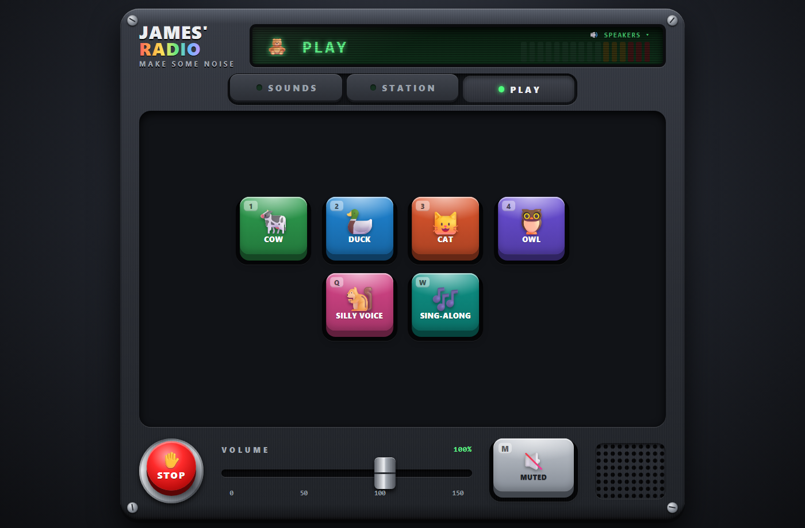

# Super Sound Pad

A toy soundboard for Windows: 24 synthesized sounds on big glowing pads. Every sound is generated with numpy
when the program starts. There are no audio files and nothing is downloaded.

Tap a pad or press its key. The keys follow the grid's shape on the keyboard:

| Row | Keys | Sounds |
|---|---|---|
| 1 | `1 2 3 4 5 6` | Air horn, Applause, Ba-dum-tss, Drum roll, Ta-da!, Cha-ching |
| 2 | `Q W E R T Y` | Ding!, Buzzer, Sad trombone, Siren, Car horn, Countdown |
| 3 | `A S D F G H` | Fart, Boing, Slide whistle, Bubbles, Crickets, Ghost |
| 4 | `Z X C V B N` | Laser, Explosion, Robot, Power up, Magic, Record scratch |

**Space** (or Esc) stops all sounds. The page also has a STOP button, a volume fader (0-150%) and a level meter.

Python plays the sound through one audio stream. The pad itself is a small web page served on 127.0.0.1 only,
opened in a Microsoft Edge app window (or your default browser if Edge is missing). Closing the window ends the
program.

## Requirements

- Windows 10 or 11 (the sound goes through the Windows WASAPI audio API)
- Python 3.10 or newer, run through [uv](https://docs.astral.sh/uv/getting-started/installation/). uv installs
  Python and the two libraries (numpy, sounddevice) by itself.
- A sound output: speakers or headphones

## Run

```
uv run soundboard.py
```

Or double-click `Play.cmd`, which checks that uv is installed and then runs the same command. Any options you
give `Play.cmd` are passed on.

Options:

- `--out "<part of name>"` plays through the output device whose name contains that text, for example
  `uv run soundboard.py --out "Speakers (USB"`. Without it, the pad uses the Windows default output. If the named
  device is missing, the pad plays on the default output and checks every 5 seconds for the named one to return.
- `--no-window` serves the page but does not open a window. The program prints the address; open it within
  90 seconds, or the program exits.

To find device names, list them with the microphone tool below: `uv run mic_echo.py --list`.

## Microphone echo (mic_echo.py)

`mic_echo.py` plays a microphone straight out of an output device, so you hear yourself on the speaker. It
reconnects by itself if the mic or the speaker drops out. Stop it with Ctrl+C.

```
uv run mic_echo.py --list
uv run mic_echo.py --in "Microphone (USB" --out "Speakers (USB" --gain 0.3
```

- `--list` lists the microphones and output devices, then exits
- `--in "<part of name>"` picks the microphone (default: Windows default)
- `--out "<part of name>"` picks the output device (default: Windows default)
- `--gain <n>` sets the loudness from 0 to 2 (default 0.3)
- `--seconds <n>` stops after that many seconds (default: run until Ctrl+C)
- `--api "<name>"` picks the audio API (default `Windows WASAPI`, the lowest delay; `MME` is a fallback)

The name given to `--in` or `--out` must match exactly one device. Keep the mic pointed away from the speaker,
or it will howl.

## Screenshot



## Note

Made for a three-year-old, shared as is.

## License

[MIT](LICENSE)
